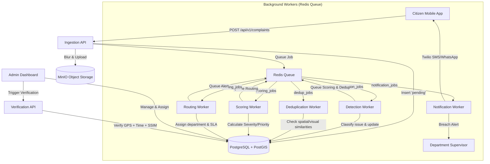

# UrbanPulse Civic Issue Tracking System

UrbanPulse is a modern, microservice-based civic-issue tracking and resolution platform. It enables citizens to capture and submit photos of infrastructure issues (potholes, broken streetlights, waterlogging, etc.) via a mobile app, automatically registers their GPS location, blurs faces and license plates for privacy, routes them dynamically to the correct municipal departments, calculates resolution deadlines (SLAs) based on severity, and validates the fixes using before/after image verification.

---

## 📊 Presentation & SRS (Software Requirements Specification)

Use the following information to structure your PowerPoint (PPT) presentation.

### 1. Problem Statement
Municipal authorities often struggle with managing civic infrastructure issues due to:
- **Fragmented Reporting**: Citizens use disjointed channels (phone calls, emails, social media).
- **Duplicate Complaints**: High volume of redundant reports for the same physical issue.
- **Manual Bottlenecks**: Manual categorization, routing, and prioritization lead to severe delays.
- **Lack of Transparency**: Citizens are left in the dark regarding the status of their complaints.
- **Verification Gaps**: Difficulty in verifying if field workers actually completed repairs to a high standard.

### 2. Proposed Solution (UrbanPulse)
UrbanPulse bridges the gap between citizens and municipal authorities by automating the ingestion, categorization, routing, and verification of civic complaints using modern Artificial Intelligence (AI) and Geographic Information Systems (GIS).

### 3. Key Stakeholders
- **Citizens**: Use the mobile app to report issues, provide descriptions, and track resolution timelines.
- **Municipal Operators (Admins)**: Use the web dashboard to monitor city-wide issues, manage SLA breaches, and oversee department workloads.
- **Field Workers / Departments**: Receive assigned tasks, perform physical repairs, and submit verification proof.

### 4. Core Features & Capabilities
- **Smart Issue Capture**: Citizens can capture photos of issues (potholes, streetlights, waterlogging) or upload from the gallery.
- **Context-Aware Submissions**: Users can select issue categories and add brief textual descriptions.
- **Automated Geolocation**: Auto-fills highly accurate GPS coordinates from the mobile device sensor.
- **Privacy-First (AI)**: Automatically blurs faces and license plates in uploaded photos before they reach the municipal database.
- **Spatial Deduplication (AI)**: Uses CLIP embeddings and PostGIS to detect and merge duplicate reports within a 500m radius over a 30-day window.
- **Automated Routing & SLA**: Calculates priority/severity scores and routes complaints to the appropriate department with strict Service Level Agreement (SLA) deadlines.
- **Repair Verification**: Validates completed fixes using before/after image EXIF data, timestamps, and visual structural similarity (SSIM).

### 5. System Requirements Specification (SRS) Highlights

#### Functional Requirements
1. **User Reporting**: The mobile app must allow users to submit images, GPS data, issue categories, and descriptions.
2. **Issue Categorization**: The system must automatically analyze images to confirm issue classification and severity.
3. **Data Privacy**: The ingestion API must apply facial and license plate obfuscation to all media.
4. **Deduplication**: The system must compare new complaints against active complaints using spatial (GPS) and visual (AI) embeddings.
5. **Routing & Tracking**: The system must route tickets to correct municipal departments and calculate dynamic resolution deadlines based on urgency.
6. **Dashboard Monitoring**: The web dashboard must plot active complaints on a GIS map and provide filtering by status, department, and issue type.

#### Non-Functional Requirements
1. **Scalability**: The microservices architecture must support horizontal scaling via Docker and a Redis-backed job queue for background workers.
2. **Performance**: Heavy tasks (object detection, deduplication, scoring) must execute asynchronously to keep the citizen-facing API latency low (under 500ms).
3. **Availability**: The system must utilize robust databases (PostgreSQL) and object storage (MinIO) to prevent data loss.
4. **Security**: API endpoints must validate payloads, and sensitive geographic data should be stored securely using PostGIS spatial columns.

---

## 🏗️ Architecture Overview

The system is composed of several specialized microservices communicating via a database and a Redis-backed job queue, coupled with web and mobile frontends.



---

## 📋 Microservices & Components

| Component / Service | Technology | Port / Type | Purpose |
| :--- | :--- | :--- | :--- |
| **`ingestion-api`** | FastAPI, Pydantic | `8001` | Receives photos, extracts GPS/EXIF metadata, blurs faces/plates, uploads to MinIO, and queues jobs. |
| **`detection-service`** | Python, YOLOv8 | Worker | Runs object detection and segmentation on images to classify issues and score confidence. |
| **`dedup-service`** | Python, CLIP, pgvector | Worker | Generates embeddings, queries PostGIS + pgvector to find duplicate reports within 500m/30 days. |
| **`scoring-service`** | Python | Worker | Computes priority and severity scores using location context multipliers and issue class. |
| **`routing-service`** | Python | Worker | Assigns complaints to departments based on geographic boundaries and schedules SLA timers. |
| **`notification-service`** | Python, Twilio | Worker | Dispatches template-based SMS and WhatsApp notifications for assignments, escalations, and resolutions. |
| **`verification-service`** | FastAPI | `8002` | Verifies repair reports using before/after EXIF location, time checks, and visual correlation proxies. |
| **`admin-dashboard`** | React, Vite, Mapbox | Web App (`5173`) | GIS Map-based control dashboard for municipal operators to filter, monitor, and assign issues. |
| **`citizen-app`** | React Native, Expo | Mobile App | Mobile app allowing citizens to take photos, capture GPS location, and check report histories. |

---

## 🛠️ Prerequisites

Before running the project, make sure you have the following installed on your system:
- **Docker Desktop** (with Compose)
- **Python 3.11+**
- **Node.js 18+** (with `npm`)

---

## 🚀 Quick Start Guide

### Step 1: Start Infrastructure Containers
Launch PostgreSQL + PostGIS, Redis, and MinIO in the background:
```bash
docker compose up -d
```

### Step 2: Database Setup & Migrations
Create the database and apply the schema migrations in order. If you have the `psql` client installed locally, execute:
```bash
# Create the database
createdb -U postgres urbanpulse

# Apply migrations
psql -U postgres -d urbanpulse -f infra/migrations/001_extensions.sql
psql -U postgres -d urbanpulse -f infra/migrations/002_departments.sql
psql -U postgres -d urbanpulse -f infra/migrations/003_complaints.sql
psql -U postgres -d urbanpulse -f infra/migrations/004_complaint_embeddings.sql
psql -U postgres -d urbanpulse -f infra/migrations/005_repair_verifications.sql
psql -U postgres -d urbanpulse -f infra/migrations/006_indexes.sql
psql -U postgres -d urbanpulse -f infra/migrations/007_add_escalation.sql

# Seed default departments
psql -U postgres -d urbanpulse -f infra/seed/departments_seed.sql
```

---

## ⚙️ Running the Backend Services

### Option A: Automatic Startup (Windows Only)
Run the pre-configured batch script at the root directory. It automatically spins up Docker containers, creates virtual environments, installs requirements for all 7 services, and spawns their processes in separate command prompt windows:
```cmd
start_backend.bat
```

### Option B: Manual Startup (Cross-Platform)
To run each service individually, navigate to its directory under `services/`, create a virtual environment, install requirements, and run the start command.

#### 1. Ingestion API
```bash
cd services/ingestion-api
python -m venv venv
source venv/bin/activate      # Windows: venv\Scripts\activate
pip install -r requirements.txt
uvicorn app.main:app --port 8001 --reload
```

#### 2. Detection Service
```bash
cd services/detection-service
python -m venv venv
source venv/bin/activate      # Windows: venv\Scripts\activate
pip install -r requirements.txt
python -m app.main
```

#### 3. Deduplication Service
```bash
cd services/dedup-service
python -m venv venv
source venv/bin/activate      # Windows: venv\Scripts\activate
pip install -r requirements.txt
python -m app.main
```

#### 4. Scoring Service
```bash
cd services/scoring-service
python -m venv venv
source venv/bin/activate      # Windows: venv\Scripts\activate
pip install -r requirements.txt
python -m app.main
```

#### 5. Routing & SLA Service
```bash
cd services/routing-service
python -m venv venv
source venv/bin/activate      # Windows: venv\Scripts\activate
pip install -r requirements.txt
python -m app.main
```

#### 6. Notification Service
```bash
cd services/notification-service
python -m venv venv
source venv/bin/activate      # Windows: venv\Scripts\activate
pip install -r requirements.txt
python -m app.main
```

#### 7. Verification API
```bash
cd services/verification-service
python -m venv venv
source venv/bin/activate      # Windows: venv\Scripts\activate
pip install -r requirements.txt
uvicorn app.main:app --port 8002 --reload
```

---

## 🖥️ Running the Frontend Applications

### 1. Admin Dashboard (React + Vite)
1. Navigate to the folder and install dependencies:
   ```bash
   cd apps/admin-dashboard
   npm install
   ```
2. *(Optional)* Add your Mapbox token in a `.env` file (`VITE_MAPBOX_TOKEN=your_token`). If omitted, the app runs in fallback/offline mode.
3. Start the dev server:
   ```bash
   npm run dev
   ```
4. Access the dashboard at [http://localhost:5173](http://localhost:5173).

### 2. Citizen Mobile App (React Native + Expo)
1. Navigate to the folder and install dependencies:
   ```bash
   cd apps/citizen-app
   npm install
   ```
2. Start the Expo developer server:
   ```bash
   npm run start
   ```
3. View the app:
   - **Web Browser**: Press `w` in your terminal to open it in a desktop web page (using React Native Web).
   - **Mobile Device**: Install **Expo Go** on your iOS/Android phone and scan the terminal's QR code.

---

## 🧪 Running Tests

### Infrastructure Tests
```bash
cd infra
pip install -r tests/requirements.txt
pytest tests/ -v
```

### Microservice Tests
Each microservice contains its own test suite using mocked external systems, meaning they do not require running Docker containers or active databases to pass.

To run tests for a service (e.g., `ingestion-api`):
```bash
cd services/ingestion-api
venv/Scripts/activate          # or source venv/bin/activate
pytest tests/ -v
```
*(Repeat the same pattern for the other 6 folders in `services/`)*

### Frontend Tests
Run unit tests for the frontend apps:
```bash
# Admin Dashboard
cd apps/admin-dashboard
npm run test

# Citizen Mobile App
cd apps/citizen-app
npm run test
```

---

## 📁 Project Structure

```
UrbanPulse/
├── apps/
│   ├── admin-dashboard/       # Operator Web Dashboard (React + Vite)
│   └── citizen-app/           # Citizen Reporting App (React Native + Expo)
├── infra/
│   ├── migrations/            # SQL migration files (001 - 007)
│   ├── seed/                  # Database seeding scripts
│   ├── schema.md              # Extensive ER diagrams & table docs
│   └── tests/                 # Database schema validations
├── services/
│   ├── ingestion-api/         # REST API for complaint submission
│   ├── detection-service/     # CV classification worker
│   ├── dedup-service/         # CLIP similarity matching worker
│   ├── scoring-service/       # Priority calculations worker
│   ├── routing-service/       # Geographic/SLA assignment worker
│   ├── notification-service/  # SMS and WhatsApp alerts worker
│   └── verification-service/  # Repair proof verification API
├── docker-compose.yml         # Dev services: PostgreSQL, Redis, MinIO
└── start_backend.bat          # Automated startup batch script
```


<!-- FIRST STEP: docker compose up -d
SECOND : .\start_backend.bat
THIRDd: cd apps/admin-dashboard
npm install
npm run dev
FOURTH: cd apps/citizen-app
npm install
npm run start -->


<!-- 
6. ACTUAL LOCAL URLS
Backend (Ingestion API): http://localhost:8006
Admin Dashboard: http://localhost:8083
Citizen App: http://localhost:8081

7. STARTUP COMMANDS

docker:
docker compose up

Backend:
cd c:\Users\HP\UrbanPulse\services\ingestion-api
.\venv\Scripts\uvicorn 
app.main:app --port 8006 --host 0.0.0.0

Admin Dashboard:
cd c:\Users\HP\UrbanPulse\apps\admin-dashboard
npm run dev

Citizen App:

npm run start

<!-- 3. ACTUAL ADMIN CREDENTIALS

Email/User ID: admin@urbanpulse.local
Password: Admin@12345 -->
